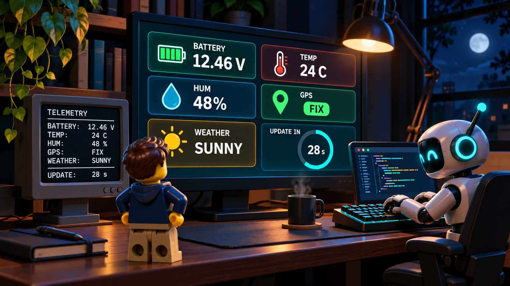
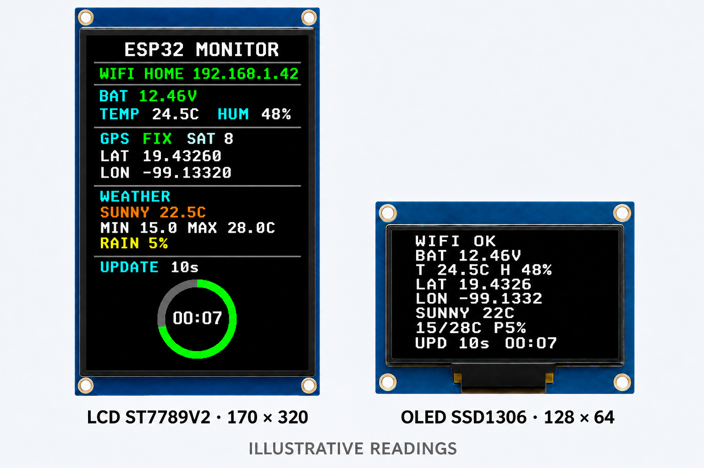
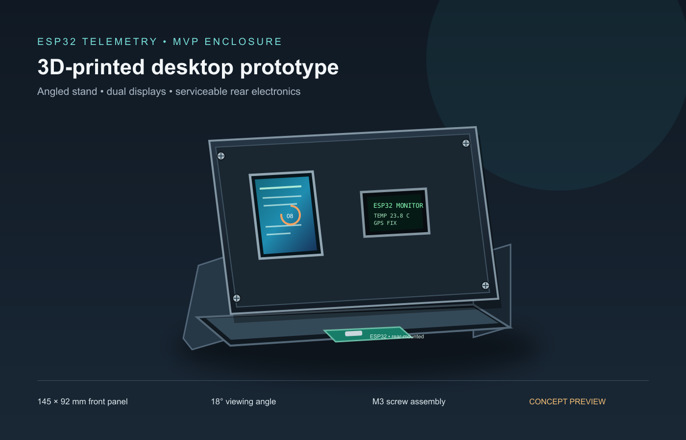
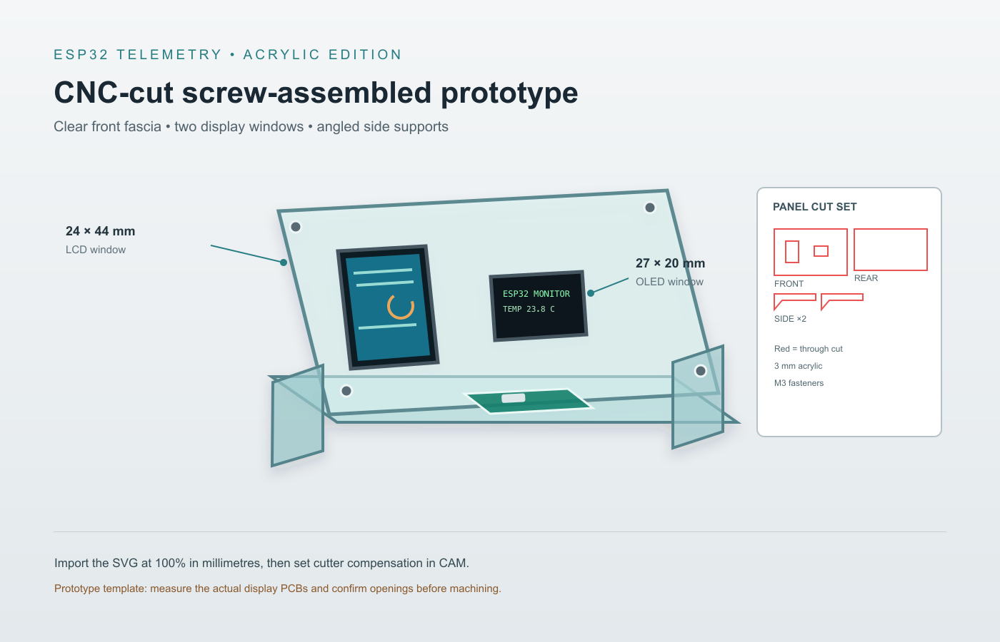

# ESP32 Telemetry Monitor

[](https://www.espressif.com/en/products/socs/esp32) [](LICENSE-MIT) [](c/README.md) [](python/README.md) [](rust/README.md) [](arduino/README.md) [](https://github.com/bygregonline/esp32-sample1/commits/master)

## Abstract

This project was generated 100% by artificial intelligence to test mixed capabilities across firmware, web servers, documentation, and hardware diagrams. The experiment focuses on respecting sandbox boundaries and keeping the repository and low-level ESP32 server code well structured for bare-metal-class hardware. It is free to use under either the [MIT License](LICENSE-MIT) or the [Apache License 2.0](LICENSE-APACHE).



A multi-implementation ESP32 telemetry project for DHT22 temperature/humidity, NEO-6M GPS, battery voltage, a 170×320 color LCD, and a 128×64 OLED. The C, MicroPython, and Rust versions include a web API, Wi-Fi setup, and Open-Meteo forecasts. The Arduino version currently reads the sensors and renders the displays.

The three full-featured versions share an API contract; C / ESP-IDF is the reference implementation. Arduino currently covers the sensor and display path:

| Directory | Stack | Web server | Weather |
|-----------|-------|-----------|---------|
| [`c/`](c/) | C / ESP-IDF 5.x | ✅ ESP HTTP server | ✅ HTTPS |
| [`python/`](python/) | MicroPython | ✅ usocket | ✅ urequests |
| [`rust/`](rust/) | Rust / esp-idf-svc (std) | ✅ EspHttpServer | ✅ HTTPS |
| [`arduino/`](arduino/) | Arduino (C++) | — | — |

> **Source of truth:** the C / ESP-IDF implementation. Python and Rust aim to keep API behavior in parity with C. Arduino does not yet include networking or weather features.

---

## Table of contents

- [Hardware](#hardware)
- [Pin map](#pin-map)
- [What it displays](#what-it-displays)
- [HTTP API](#http-api)
  - [GET /api/status](#get-apistatus)
  - [GET /api/sensors](#get-apisensors)
  - [GET /api/weather](#get-apiweather)
  - [POST /api/config/interval](#post-apiconfiginterval)
  - [POST /api/config/display](#post-apiconfigdisplay)
  - [POST /wifi](#post-wifi)
- [curl examples](#curl-examples)
- [Project structure](#project-structure)
- [Documentation](#documentation)
- [Building and flashing](#building-and-flashing)
  - [C / ESP-IDF](#c--esp-idf)
  - [Python / MicroPython](#python--micropython)
  - [Rust / esp-idf-svc](#rust--esp-idf-svc)
  - [Arduino](#arduino)
- [Wi-Fi setup](#wi-fi-setup)
- [Wokwi simulation (C only)](#wokwi-simulation-c-only)

---

## Hardware

- **Board:** ESP32 DevKit / WROOM-32 (Xtensa LX6 dual-core, 240 MHz)
- **LCD:** Waveshare 1.9" 170×320 ST7789V2, SPI
- **OLED:** Generic 0.96" 128×64 SSD1306, I2C
- **Temperature/Humidity:** DHT22
- **GPS:** u-blox NEO-6M, UART 9600 baud
- **Battery voltage:** 0–25 V module (5:1 divider) + external 12 kΩ/10 kΩ divider into ADC1 GPIO34

### Wiring diagrams and display mockup

#### Breadboard assembly


The ESP32 sits between two separate breadboard sections so the displays can connect on the left and the sensors on the right. Each five-hole strip connects horizontally; the power rails connect vertically. Numbered rows on opposite sections are isolated unless a jumper explicitly joins them. Insulated wires that pass over a rail connect only at their marked endpoint holes.

The left section uses rows 3/5/39/34/32 for LCD SCK/MOSI/CS/DC/RST and rows 7/9 for OLED SCL/SDA. The right section uses row 51 for DHT22 DATA, rows 34/32 for GPS TX/RX, row 55 for the divided ADC output, and row 58 for the voltage module's raw S signal. The shown cross-section jumpers join rows 3, 5, 7, 9, 51, and 55 only. Place the 12 kΩ resistor between right-side rows 58 and 55, the 10 kΩ resistor between right-side row 55 and ground, and the DHT22 4.7 kΩ pull-up between right-side row 51 and 3V3.

#### Wiring overview


#### LCD and OLED preview



---

## Pin map

| Module | Signal | ESP32 GPIO |
|--------|--------|-----------|
| LCD ST7789V2 | SCK | 18 |
| LCD ST7789V2 | MOSI | 23 |
| LCD ST7789V2 | CS | 13 |
| LCD ST7789V2 | DC | 27 |
| LCD ST7789V2 | RST | 26 |
| LCD ST7789V2 | BL | 3V3 (hardwired) |
| OLED SSD1306 | SDA | 21 |
| OLED SSD1306 | SCL | 22 |
| OLED SSD1306 | I2C address | 0x3C |
| DHT22 | DATA | 33 |
| GPS NEO-6M | TX → ESP RX | 16 |
| GPS NEO-6M | RX ← ESP TX | 17 (optional) |
| Battery ADC | Signal | 34 |

### Battery voltage divider

The 0–25 V sensor module has a built-in 5:1 divider (max 5 V output). To protect the ESP32 ADC (max ~2.45 V at 11 dB attenuation), add an external resistor divider:

```text
Battery → [0-25V module] → S pin
                                ↓
                             12 kΩ
                                ↓
                           GPIO34 ──── ADC1
                                ↓
                             10 kΩ
                                ↓
                              GND
```

Combined ratio: **5.0 × 2.2 = 11×**. Calibrate `VOLTAGE_CALIBRATION` against a multimeter in each implementation's config file.

---

## What it displays

Both displays share the same layout and are updated every second.

### LCD 170×320 (color)

```text
┌─────────────────────────────┐
│ ESP32 MONITOR               │  ← title (blue)
├─────────────────────────────┤
│ WIFI MyNetwork  192.168.1.x │  ← green when connected
├─────────────────────────────┤
│ BAT  12.34V                 │  ← green >3.5V, yellow otherwise
├─────────────────────────────┤
│ TEMP  24.1C    HUM  55%     │
├─────────────────────────────┤
│ GPS  FIX  SAT 9             │
│ LAT  19.43260               │
│ LON -99.13320               │
├─────────────────────────────┤
│ CLIMA                       │
│ SOLEADO       22.5C         │
│ MIN 15.0  MAX 28.0C         │
│ LLUVIA 5%                   │
├─────────────────────────────┤
│ UPDATE  10s   PROX 00:07    │  ← sensor cycle + countdown
│        ◯ (animated ring)    │  ← green→yellow→red arc
└─────────────────────────────┘
```

### OLED 128×64 (monochrome)

```text
WIFI OK
BAT 12.34V
T 24.1C H 55%
LAT 19.4326
LON -99.1332
SOLEADO  22C
15/28C P5%
UPD 10s  00:07
```

Both displays respect the `display_fields_mask` — individual sections can be hidden via the API without restarting.

---

## HTTP API

All three server implementations (C, Python, Rust) expose identical endpoints returning the same JSON structure.

**Base URL:** `http://<device-ip>/`
From the config AP: `http://192.168.4.1/`

| Method | Path | Description |
|--------|------|-------------|
| GET | `/` | HTML dashboard (auto-refreshes every 2 s) |
| GET | `/api/status` | Full monitor snapshot |
| GET | `/api/sensors` | Last sensor reading only |
| GET | `/api/weather` | Weather forecast only |
| POST | `/api/config/interval` | Set sensor cycle interval (5–300 s) |
| POST | `/api/config/display` | Show/hide display sections |
| POST | `/wifi` | Save Wi-Fi credentials |

---

### GET /api/status

Full snapshot of all subsystems.

```bash
curl http://<IP>/api/status
```

```json
{
  "sensors": {
    "battery_v": 12.34,
    "temperature_c": 24.1,
    "humidity_percent": 55.0,
    "dht_valid": true,
    "last_read_ms": 45000
  },
  "gps": {
    "fix": true,
    "latitude": 19.4326,
    "longitude": -99.1332,
    "satellites": 9
  },
  "wifi": {
    "connected": true,
    "ssid": "MyNetwork",
    "ip": "192.168.1.42"
  },
  "refresh": {
    "interval_seconds": 10,
    "weather_interval_seconds": 300,
    "remaining_seconds": 7
  },
  "display_mask": 15,
  "weather": {
    "available": true,
    "summary": "SOLEADO",
    "weather_code": 0,
    "current_temperature_c": 22.5,
    "current_humidity_percent": 48.0,
    "minimum_temperature_c": 15.0,
    "maximum_temperature_c": 28.0,
    "precipitation_probability": 5,
    "age_seconds": 120,
    "stale": false
  }
}
```

---

### GET /api/sensors

Last sensor reading with time remaining until next cycle.

```bash
curl http://<IP>/api/sensors
```

```json
{
  "battery_v": 12.34,
  "temperature_c": 24.1,
  "humidity_percent": 55.0,
  "dht_valid": true,
  "gps_fix": true,
  "latitude": 19.4326,
  "longitude": -99.1332,
  "satellites": 9,
  "last_read_ms": 45000,
  "interval_seconds": 10,
  "remaining_seconds": 7
}
```

---

### GET /api/weather

Weather forecast from the last GPS position.

```bash
curl http://<IP>/api/weather
```

```json
{
  "available": true,
  "summary": "LLUVIA",
  "weather_code": 61,
  "current_temperature_c": 18.2,
  "current_humidity_percent": 82.0,
  "minimum_temperature_c": 14.0,
  "maximum_temperature_c": 21.0,
  "precipitation_probability": 80,
  "age_seconds": 45,
  "stale": false
}
```

---

### POST /api/config/interval

Change the sensor read cycle at runtime. **Range: 5–300 seconds.** Takes effect on the next cycle.

```bash
curl -X POST http://<IP>/api/config/interval \
     -H "Content-Type: application/json" \
     -d '{"interval_seconds": 30}'
```

Also accepts a query string:

```bash
curl -X POST "http://<IP>/api/config/interval?seconds=30"
```

**Response:**

```json
{ "ok": true, "interval_seconds": 30 }
```

**Error response:**

```json
{ "ok": false, "error": "interval_seconds fuera de rango (5-300)" }
```

---

### POST /api/config/display

Show or hide individual sections on both LCD and OLED without rebooting. Omitted fields keep their current state.

```bash
# Show all sections
curl -X POST http://<IP>/api/config/display \
     -H "Content-Type: application/json" \
     -d '{"battery": true, "dht": true, "gps": true, "weather": true}'

# Compact mode — battery and temperature only
curl -X POST http://<IP>/api/config/display \
     -H "Content-Type: application/json" \
     -d '{"battery": true, "dht": true, "gps": false, "weather": false}'

# Navigation mode — GPS only
curl -X POST http://<IP>/api/config/display \
     -H "Content-Type: application/json" \
     -d '{"battery": false, "dht": false, "gps": true, "weather": false}'
```

**Response:**

```json
{
  "ok": true,
  "display_mask": 3,
  "battery": true,
  "dht": true,
  "gps": false,
  "weather": false
}
```

> `display_mask` bitmask: bit 0 = battery, bit 1 = DHT22, bit 2 = GPS, bit 3 = weather.
> `0x0F` (15) = all visible. `0x00` = all hidden.

---

### POST /wifi

Save Wi-Fi credentials. Persisted in NVS (C/Rust) or `wifi_creds.json` (Python). Survives reboots.

```bash
curl -X POST http://192.168.4.1/wifi \
     -H "Content-Type: application/x-www-form-urlencoded" \
     -d "ssid=MyNetwork&password=YOUR_WIFI_PASSWORD"
```

**Response (plain text):**

```text
Guardadas. El dispositivo se reconectara.
```

---

## curl examples

### First-time setup workflow

```bash
# 1. Connect your computer to the ESP32 config AP:
#    SSID: ESP32-Monitor-Setup  /  Password: monitor1234

# 2. Configure home Wi-Fi
curl -X POST http://192.168.4.1/wifi \
     -H "Content-Type: application/x-www-form-urlencoded" \
     -d "ssid=MyHomeNetwork&password=YOUR_WIFI_PASSWORD"

# 3. Wait ~10 s, then check the device IP on the display and verify connection
curl http://192.168.1.42/api/status | python3 -m json.tool

# 4. Set sensor cycle to 20 seconds
curl -X POST http://192.168.1.42/api/config/interval \
     -H "Content-Type: application/json" \
     -d '{"interval_seconds": 20}'

# 5. Check current sensor reading
curl http://192.168.1.42/api/sensors

# 6. Check weather forecast
curl http://192.168.1.42/api/weather

# 7. Compact display — hide GPS and weather
curl -X POST http://192.168.1.42/api/config/display \
     -H "Content-Type: application/json" \
     -d '{"battery": true, "dht": true, "gps": false, "weather": false}'
```

### Continuous monitoring

```bash
# Refresh every 5 seconds
watch -n 5 'curl -s http://192.168.1.42/api/sensors | python3 -m json.tool'

# One-liner: battery and temperature only
watch -n 10 'curl -s http://192.168.1.42/api/sensors | \
  python3 -c "import json,sys; d=json.load(sys.stdin); \
  print(\"Bat:\", d[\"battery_v\"], \"V  |  T:\", d[\"temperature_c\"], \"C\")"'
```

### Interval presets

```bash
# Fast — 5 s (minimum)
curl -X POST http://<IP>/api/config/interval \
     -H "Content-Type: application/json" -d '{"interval_seconds": 5}'

# Normal — 10 s (default)
curl -X POST http://<IP>/api/config/interval \
     -H "Content-Type: application/json" -d '{"interval_seconds": 10}'

# Slow — 1 minute
curl -X POST http://<IP>/api/config/interval \
     -H "Content-Type: application/json" -d '{"interval_seconds": 60}'

# Idle — 5 minutes (maximum)
curl -X POST http://<IP>/api/config/interval \
     -H "Content-Type: application/json" -d '{"interval_seconds": 300}'
```

---

## Project structure

```text
.
├── README.md            ← this file
├── README.template.md   ← ordered README section template
├── structure.md         ← README content and badge data
├── mkdocs.yml           ← documentation site navigation and plugins
├── API.md               ← full API reference with all curl examples
├── CHANGES.md           ← session change log
├── docs/                ← MkDocs pages and approved hardware visuals
├── supportfiles/
│   ├── 3d/               ← printable OpenSCAD enclosure model and preview
│   └── cnc/              ← 1:1 acrylic cutting layout and preview
├── scripts/
│   ├── generate_readme.py  render README and repository snapshot
│   └── build_docs.sh       MkDocs + Python, C, and Rust API documentation
│
├── c/                   ← C / ESP-IDF 5.x (source of truth)
│   ├── main/
│   │   ├── main.c           main loop, DHT22 bit-bang, ADC
│   │   ├── display.c/h      LCD + OLED render, custom 5×7 font, countdown ring
│   │   ├── gps.c/h          NMEA parser (RMC + GGA), checksum validation
│   │   ├── monitor_state.c/h  FreeRTOS mutex-protected shared state
│   │   ├── network.c/h      Wi-Fi AP+STA, NVS credentials, HTTP server
│   │   ├── weather.c/h      Open-Meteo HTTPS fetch task (cJSON)
│   │   └── config.h         pin and ADC constants
│   ├── scripts/
│   │   ├── install-deps.sh  activate ESP-IDF environment
│   │   ├── build.sh         idf.py build → build/esp32_monitor_c.bin
│   │   ├── build-wokwi.sh   build with Wokwi simulation profile
│   │   └── deploy.sh        build + flash + open serial monitor
│   └── CMakeLists.txt
│
├── python/              ← MicroPython
│   ├── main.py              main loop, Wi-Fi, HTTP server, weather, display
│   ├── config.py            all pin and timing constants
│   ├── gps.py               NMEA parser (RMC + GGA)
│   ├── ssd1306.py           SSD1306 I2C driver
│   ├── st7789.py            ST7789V2 SPI driver
│   └── scripts/
│       ├── install-deps.sh  create .venv, install mpremote via uv
│       ├── build.sh         copy sources to dist/esp32-monitor-python/
│       └── deploy.sh        mpremote cp → board + reset
│
├── rust/                ← Rust / esp-idf-svc (std)
│   ├── src/
│   │   ├── main.rs          entry point, peripherals init, main loop
│   │   ├── monitor_state.rs Arc<Mutex<MonitorData>>, same API as C
│   │   ├── display.rs       LCD + OLED render, same layout as C
│   │   ├── network.rs       Wi-Fi AP+STA, NVS, HTTP server, all endpoints
│   │   ├── weather.rs       Open-Meteo HTTPS fetch thread
│   │   └── gps.rs           NMEA parser (RMC + GGA)
│   ├── .cargo/config.toml   target: xtensa-esp32-espidf (std)
│   ├── build.rs             embuild ESP-IDF bindings
│   ├── Cargo.toml           esp-idf-svc, mipidsi, ssd1306, embedded-graphics
│   ├── rust-toolchain.toml  channel = "esp" (espup)
│   └── scripts/
│       ├── install-deps.sh  install espup, espflash
│       ├── build.sh         cargo build --release → firmware.bin
│       └── deploy.sh        build + espflash + monitor
│
└── arduino/             ← Arduino (display + sensors only, no web server)
    ├── esp32_monitor/
    │   ├── esp32_monitor.ino  full sketch
    │   └── config.h           pin and timing constants
    └── scripts/
        ├── install-deps.sh  arduino-cli core + libraries
        ├── build.sh         compile → dist/
        └── deploy.sh        compile + upload via arduino-cli
```

---

## Documentation

The root README is generated from [`structure.md`](structure.md) and [`README.template.md`](README.template.md). Edit those source files, then render or check the result:

```sh
python3 scripts/generate_readme.py
python3 scripts/generate_readme.py --check
```

The pre-commit hook also renders `README.md`; stage the generated file if the hook updates it.

The MkDocs skeleton includes hardware, HTTP API, and implementation pages. Its Python reference is generated from source docstrings with `mkdocstrings`. MkDocs, its theme, and the Python handler are in the `uv` development dependency group:

```sh
uv sync --group dev
./scripts/build_docs.sh
```

The site is written to ignored `site/`. Optional native API generators add C Doxygen and Rust rustdoc HTML to that site:

```sh
./scripts/build_docs.sh --c-api     # requires Doxygen installed separately
./scripts/build_docs.sh --rust-api  # requires the ESP Rust toolchain
./scripts/build_docs.sh --all       # both native generators
```

---

## Building and flashing

### C / ESP-IDF

Requires ESP-IDF 5.x. Install it from the [Espressif getting started guide](https://docs.espressif.com/projects/esp-idf/en/latest/esp32/get-started/).

```bash
cd c/

# Install / activate ESP-IDF environment (once per machine)
./scripts/install-deps.sh

# Compile — no board needed
./scripts/build.sh
# → build/esp32_monitor_c.bin

# Flash + open serial monitor (board must be connected)
./scripts/deploy.sh

# Custom port
ESP32_PORT=/dev/cu.usbserial-0001 ./scripts/deploy.sh
```

#### Wokwi simulation

```bash
# Build the simulation profile
./scripts/build-wokwi.sh

# Then in VS Code: Cmd+Shift+P → "Wokwi: Start Simulator"
# Web panel: http://localhost:8180/
# API:       http://localhost:8180/api/status
```

---

### Python / MicroPython

Requires MicroPython firmware on the board (must include `dht`, `machine`, `framebuf`).

```bash
cd python/

# Install mpremote in the shared .venv (uses uv)
./scripts/install-deps.sh

# Copy files to board and reset
./scripts/deploy.sh

# Custom port
ESP32_PORT=port:/dev/cu.usbserial-0001 ./scripts/deploy.sh

# Open serial console
./../.venv/bin/mpremote connect auto repl
```

Config is in `python/config.py`. Credentials are saved to `wifi_creds.json` on the board's filesystem.

---

### Rust / esp-idf-svc

Requires the Espressif Rust toolchain (`espup`) and `espflash`.

```bash
cd rust/

# Install espup + espflash + ldproxy (once per machine)
./scripts/install-deps.sh

# Activate the Xtensa toolchain environment
. ./export-esp.sh

# Compile — no board needed
./scripts/build.sh
# → firmware.bin  and  target/xtensa-esp32-espidf/release/esp32-monitor-rust

# Flash + monitor (board must be connected)
./scripts/deploy.sh

# Custom port
ESP32_PORT=/dev/cu.usbserial-0001 ./scripts/deploy.sh
```

The target is `xtensa-esp32-espidf` (std, ESP-IDF bindings via `esp-idf-sys`). ESP-IDF version is pinned to `v5.4.2` in `.cargo/config.toml` and managed automatically by `embuild`.

---

### Arduino

Requires Arduino CLI or Arduino IDE with the ESP32 core.

```bash
cd arduino/

# Install arduino-cli, ESP32 core, and libraries
./scripts/install-deps.sh

# Compile — no board needed
./scripts/build.sh
# → dist/

# Compile + upload (board must be connected)
ESP32_PORT=/dev/cu.usbserial-0001 ./scripts/deploy.sh
```

> The Arduino implementation covers sensors and display only — there is no web server or weather fetch.

---

## Wi-Fi setup

On first boot (or when no credentials are saved), the device creates a configuration access point:

- **SSID:** `ESP32-Monitor-Setup`
- **Password:** `monitor1234`
- **Portal URL:** `http://192.168.4.1`

The AP stays active at all times alongside the STA connection, so you can always reconfigure from that address. Once connected to a home network, the device IP appears on the LCD and OLED. You can also use the `/wifi` endpoint directly:

The access point password shown here is a public example compiled into C, Rust, and MicroPython. Change it in the corresponding implementation before using a device outside a trusted test environment.

```bash
curl -X POST http://192.168.4.1/wifi \
     -H "Content-Type: application/x-www-form-urlencoded" \
     -d "ssid=MyNetwork&password=YOUR_WIFI_PASSWORD"
```

---

## Wokwi simulation (C only)

The simulation profile (`wokwi.toml` + `diagram.json` at the repo root) runs the C firmware in Wokwi for VS Code with:

- Fixed GPS coordinates (Mexico City: 19.4326, -99.1332)
- Simulated DHT22 and potentiometer for voltage
- `Wokwi-GUEST` open Wi-Fi network
- ILI9341 display (substitute for the ST7789V2 — same logical area)
- Port forwarding: `localhost:8180` → ESP32 port 80

```bash
cd c/
./scripts/build-wokwi.sh
# Open VS Code → Cmd+Shift+P → Wokwi: Start Simulator
```

Then test the full API from your host machine:

```bash
curl http://localhost:8180/api/status | python3 -m json.tool
curl -X POST http://localhost:8180/api/config/interval \
     -H "Content-Type: application/json" \
     -d '{"interval_seconds": 15}'
```

---

## Notes

- **DHT22 minimum interval:** 2.5 s between reads, enforced regardless of the configured sensor cycle.
- **Weather forecast:** requires Wi-Fi + GPS fix + NTP sync. Refreshes every 300 s or when GPS moves > 0.005°. Uses [Open-Meteo](https://open-meteo.com/) — no API key required.
- **NTP:** the C and Rust implementations use `pool.ntp.org`; Python uses MicroPython's built-in `ntptime`. Required for TLS certificate validation.
- **ADC calibration:** each board varies. Measure with a multimeter and adjust `VOLTAGE_CALIBRATION` in the respective config file.
- **OLED address:** default `0x3C`. Some modules use `0x3D` — change `OLED_I2C_ADDRESS` in config.

## License

This project is dual-licensed under the MIT License or Apache License, Version 2.0. You may choose either license for your use. See [LICENSE-MIT](LICENSE-MIT) and [LICENSE-APACHE](LICENSE-APACHE).

## Prototype fabrication files

The repository includes two enclosure concepts for the assembled MVP. Both place the color LCD and OLED on the front, keep the ESP32 accessible behind them, and use a desktop viewing angle.

### 3D-printed prototype

[](supportfiles/3d/esp32_mvp_assembly.stl)

The editable [OpenSCAD model](supportfiles/3d/esp32_mvp_mount.scad) and its [assembled STL](supportfiles/3d/esp32_mvp_assembly.stl) are included. The clickable preview opens GitHub's interactive STL viewer; individual [front](supportfiles/3d/esp32_mvp_front.stl), [rear](supportfiles/3d/esp32_mvp_back.stl), and [side](supportfiles/3d/esp32_mvp_side.stl) files are the print parts (print two sides). Dimensions and export instructions are in [supportfiles/3d/README.md](supportfiles/3d/README.md).

### CNC-cut acrylic prototype



The [1:1 metric SVG layout](supportfiles/cnc/esp32_mvp_acrylic_panels.svg) contains the front and rear panels and two angled side cheeks for screw assembly. Import at 100% in millimetres and configure tool compensation in CAM. See [supportfiles/cnc/README.md](supportfiles/cnc/README.md) for setup and cut dimensions.

Both concepts are fit-check prototypes. The Waveshare LCD body is 27.3 × 51.2 mm; generic SSD1306 boards vary, so measure the specific display modules and adjust the model or cutting profile before fabrication. The preview PNGs illustrate the concept; use the SCAD and SVG files for geometry.

## Repository snapshot

- **Last source commit:** [`c88306f`](https://github.com/bygregonline/esp32-sample1/commit/c88306f36445c0344e7c48373145efcbc962f2cd)
- **Commit date:** 2026-11-04T14:44:03-06:00
- **Repository size:** 8.2 MiB across 118 project files (generated `README.md` excluded)

_Snapshot captured when this README was generated._
