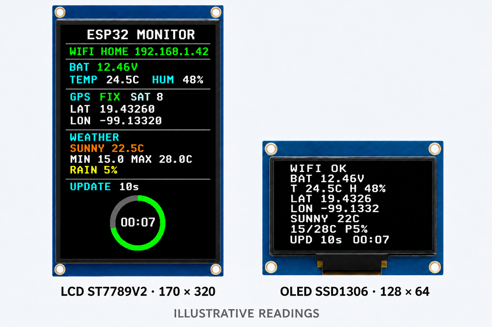

# Monitor ESP32 para Arduino IDE

Implementación para placa ESP32-S3 N16R8 de doble USB-C (16 MB flash, 8 MB PSRAM), con GPIO basados en la referencia ESP32-S3-DevKitC-1. Verifica el rotulado de la placa concreta antes de cablear. Incluye LCD Waveshare ST7789V2 de 170 × 320, OLED SSD1306 de 128 × 64, sensor DHT22, GPS NEO-6M y lectura analógica de batería.

## Diagramas y pantallas

### Montaje con protoboard


### Diagrama general de conexiones


### Diseño de referencia de las pantallas



El montaje muestra las pantallas a la izquierda del ESP32 y los sensores a la derecha. El [README principal](../README.md#wiring-diagrams-and-display-mockup) describe las filas y resistencias. La imagen de las pantallas corresponde al diseño de las versiones con clima y servidor web; este sketch de Arduino muestra sensores y GPS, sin pronóstico.

## Compilar con Arduino CLI

Arduino CLI permite preparar, compilar y subir el mismo sketch desde terminal o desde el terminal integrado de VS Code, sin extensión adicional. En macOS se puede instalar con Homebrew:

```sh
brew install arduino-cli
```

Desde esta carpeta, instala el core ESP32 y las bibliotecas del sketch:

```sh
./scripts/install-deps.sh
```

Compila sin conectar una placa:

```sh
./scripts/build.sh
```

Los binarios quedan en `dist/`. Para compilar y subir cuando la placa esté conectada, indica su puerto serial:

```sh
ESP32_PORT=/dev/cu.usbserial-0001 ./scripts/deploy.sh
```

En Linux el puerto suele ser `/dev/ttyUSB0`; en Windows, por ejemplo, `COM3`. Para otra placa, cambia el identificador con `ARDUINO_FQBN`; por defecto se usa `esp32:esp32:esp32s3:FlashSize=16M,PSRAM=opi` (ESP32-S3 N16R8). El índice de placas de Espressif se pasa en cada comando, sin cambiar la configuración global de Arduino CLI.

## Instalar en Arduino IDE

1. En Arduino IDE, agrega esta URL en **Preferencias → URLs adicionales de gestor de placas**:

   `https://espressif.github.io/arduino-esp32/package_esp32_index.json`

2. En **Gestor de placas**, instala **esp32 by Espressif Systems** y selecciona **ESP32 Dev Module**.
3. En **Gestor de bibliotecas**, instala:
   - **GFX Library for Arduino** (Arduino_GFX)
   - **Adafruit SSD1306**
   - **Adafruit GFX Library**
   - **DHT sensor library**
   - **Adafruit Unified Sensor**
   - **TinyGPSPlus**
4. Abre `esp32_monitor/esp32_monitor.ino`, selecciona el puerto de la placa y pulsa **Verificar** o **Subir**.

El LCD se maneja con Arduino_GFX y sus desplazamientos de 35 píxeles; la OLED usa Adafruit SSD1306. DHT22 y GPS se leen cada 2.5 s y continuamente, respectivamente. La batería se calcula con ocho lecturas calibradas de `analogReadMilliVolts`.

## Pines

| Módulo | ESP32 |
|---|---:|
| LCD SPI SCK / MOSI | GPIO12 / GPIO11 |
| LCD CS / DC / RST | GPIO10 / GPIO13 / GPIO14 |
| LCD BL | 3V3 (luz fija) |
| OLED I2C SDA / SCL | GPIO8 / GPIO9 |
| DHT22 DATA | GPIO6 |
| GPS TX al RX del ESP32 | GPIO18 |
| GPS RX desde TX del ESP32 (opcional) | GPIO17 |
| Sensor de voltaje S | GPIO4 (ADC1_CH3) a través del divisor adicional |

El GPS usa 9600 baudios y la OLED usa I2C `0x3C`. El DHT22 sin módulo requiere una resistencia pull-up de 4.7–10 kΩ entre DATA y 3V3. Para la entrada de batería, conecta una resistencia de 12 kΩ entre la salida `S` del módulo y GPIO4, y otra de 10 kΩ entre GPIO4 y GND. No conectes la salida del sensor ni la batería directamente al GPIO.

Los pines, desplazamientos y factores se pueden cambiar en `esp32_monitor/config.h`. Ajusta `VOLTAGE_CALIBRATION` comparando la lectura con un multímetro.
