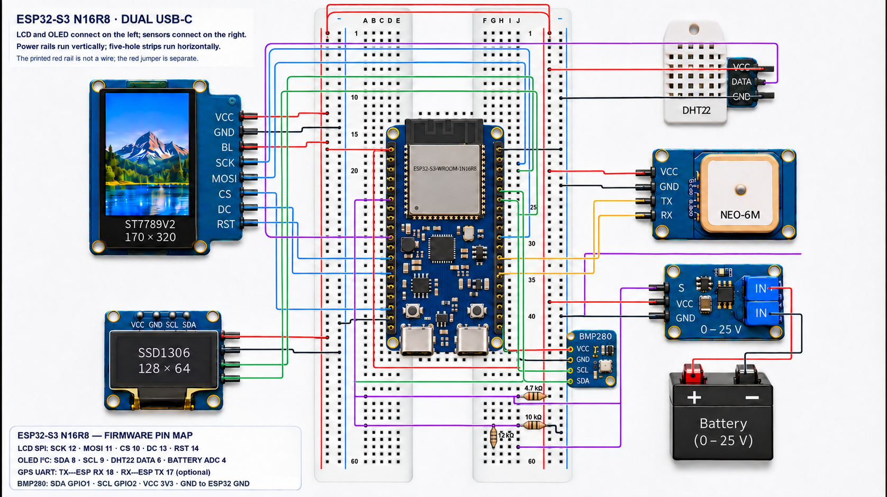
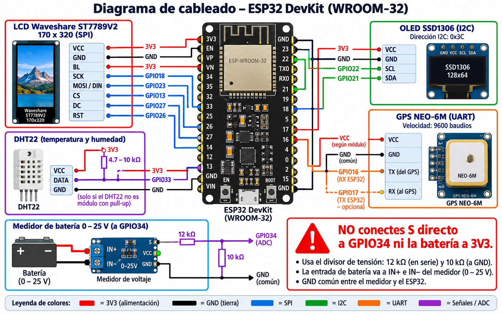
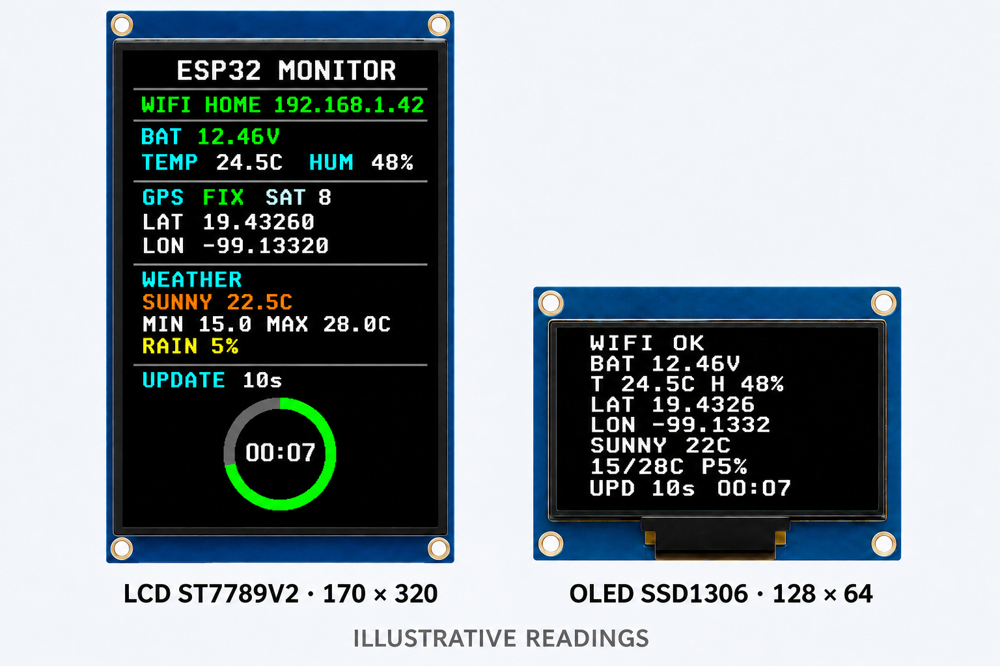

# Firmware C con ESP-IDF

Proyecto C para ESP-IDF 5.x y ESP32 clásico (DevKit/WROOM-32, Xtensa). No requiere tener la placa conectada para compilar; el archivo `.bin` se puede guardar y flashear cuando haya hardware disponible.

## Diagramas y pantallas

### Montaje con protoboard



### Diagrama general de conexiones



### Vista de las pantallas



El montaje coloca el ESP32 al centro, las pantallas a la izquierda y los sensores a la derecha. Consulta el [mapa de filas y resistencias](../README.md#wiring-diagrams-and-display-mockup) antes de cablear; los GPIO efectivos están en [`main/config.h`](main/config.h).

## Qué incluye

- LCD Waveshare ST7789V2 de 170 × 320 por SPI, desplazamiento X 35.
- OLED SSD1306 de 128 × 64 por I2C `0x3C`.
- Lectura DHT22 con temporización por microsegundos.
- GPS NEO-6M por UART1 a 9600 baudios, con lectura RMC/GGA y verificación NMEA.
- ADC1 GPIO34 con calibración del ESP-IDF cuando el chip/compilación la ofrece.
- Portal Wi-Fi protegido en SoftAP para elegir la red desde un navegador; las credenciales se guardan en NVS.
- Servidor web local con panel HTML y endpoints JSON para sensores, GPS, Wi-Fi y clima.
- Pronóstico de Open-Meteo basado en la ubicación reciente del GPS. Se consulta cada cinco minutos si hay Wi-Fi, señal GPS e internet.
- Pronóstico en ambas pantallas y cuenta regresiva de actualización; la LCD a color muestra un anillo que se reduce con el tiempo.
- Ejemplo de inferencia TensorFlow Lite Micro `float32` basado en el modelo público Hello World.

Los pines y factores están en [`main/config.h`](main/config.h). Para el voltaje usa el divisor documentado en el README raíz: resistencia de 12 kΩ entre salida `S` del módulo y GPIO34, y resistencia de 10 kΩ entre GPIO34 y GND. Calibra `VOLTAGE_CALIBRATION` comparando con un multímetro.

## TensorFlow Lite Micro: prueba float32

El firmware incluye el modelo de demostración [Hello World de TensorFlow Lite Micro](https://github.com/tensorflow/tflite-micro/tree/main/tensorflow/lite/micro/examples/hello_world), que aproxima `sin(x)`. Usamos TFLM para ejercitar inferencia `float32` en el CPU/FPU del ESP32 clásico. Este chip tiene FPU, no TPU: la prueba valida la integración del runtime, pero no es una prueba de TPU, un benchmark de rendimiento, un pronóstico meteorológico ni una clasificación de sensores.

Cada vez que se actualizan las lecturas, el firmware normaliza la temperatura y la humedad del DHT22 al rango esperado y las entrega al modelo en dos inferencias separadas, porque el modelo recibe un solo valor por vez. Si el DHT22 no está disponible, normaliza el voltaje de batería como entrada de respaldo. Las predicciones se registran en el monitor serial con la etiqueta `TFLM demo`; no modifican las pantallas ni los valores que entrega la API.

La dependencia `espressif/esp-tflite-micro` está fijada en [`components/tflm_demo/idf_component.yml`](../components/tflm_demo/idf_component.yml), y el modelo y su interfaz compartida están en [`components/tflm_demo/`](../components/tflm_demo/). C y Rust enlazan el mismo componente; el intérprete está implementado en C++ y se llama desde ambas versiones mediante una interfaz C.

## Documentación

Desde la raíz del repositorio, `./scripts/build_docs.sh` genera el sitio MkDocs. Para añadir la referencia de funciones y encabezados C, ejecuta `./scripts/build_docs.sh --c-api`; esta opción requiere Doxygen instalado aparte de las dependencias de desarrollo administradas por `uv`. El resultado queda en `site/api/c/` y se ignora en Git.

## Compilar sin placa y desplegar cuando esté disponible

Instala ESP-IDF siguiendo la [guía oficial de Espressif](https://docs.espressif.com/projects/esp-idf/en/latest/esp32/get-started/index.html) y activa su entorno en la terminal. El SDK y las herramientas se instalan con el instalador oficial de Espressif, porque el proceso depende del sistema operativo. Después, configura las dependencias del proyecto:

```sh
./scripts/install-deps.sh
```

`install-deps.sh` y `build.sh` cargan automáticamente `scripts/activate-esp-idf.sh`; no hace falta modificar `.zshrc` ni activar ESP-IDF manualmente en cada terminal. El helper detecta el script de ESP-IDF Installation Manager en `~/.espressif/tools/` o usa `IDF_PATH/export.sh`. Para EIM toma las variables con su opción `-e` y ejecuta `idf.py` con el Python de ESP-IDF. Si hay varias versiones instaladas, especifica cuál usar con `ESP_IDF_ACTIVATE=/ruta/al/activate_idf_v5.x.sh`. Para una instalación tradicional puedes definir `IDF_PATH` antes de ejecutar los scripts. Espressif documenta ambos flujos en su [guía de herramientas](https://docs.espressif.com/projects/esp-idf/en/stable/esp32/api-guides/tools/idf-tools.html).

Después, el script ejecuta `idf.py reconfigure` para configurar las dependencias del proyecto.

Desde esta carpeta, prepara la imagen:

```sh
./scripts/build.sh
```

La imagen de aplicación queda en `build/esp32_monitor_c.bin`; el cargador y las particiones se generan junto con ella. La compilación no requiere conectar el ESP32. Cuando la placa esté conectada por USB, ejecuta:

La configuración usa la tabla **Single factory app (large)** de ESP-IDF: reserva 1.5 MiB para el firmware, configura 2 MiB de flash y no incluye OTA. El módulo debe tener al menos 2 MiB de flash.

```sh
./scripts/deploy.sh
```

El script compila, carga el firmware y abre el monitor serial. Para seleccionar el puerto manualmente: `ESP32_PORT=/dev/cu.usbserial-0001 ./scripts/deploy.sh`.

La pantalla LCD usa inicialización ST7789V2 genérica; el módulo exacto puede requerir pequeños cambios de gamma, orientación o desplazamiento. La lectura analógica también necesita calibración con el módulo y divisor reales. Estas dos comprobaciones físicas quedan pendientes porque aún no está conectada la placa.

## Simular con Wokwi en VS Code

El perfil de simulación vive en `wokwi.toml` y `diagram.json` en la raíz del repositorio. Requiere la extensión **Wokwi for VS Code**. Desde la raíz del proyecto, genera primero el firmware de simulación:

```sh
./c/scripts/build-wokwi.sh
```

En VS Code, abre la carpeta raíz del repositorio y ejecuta **Wokwi: Start Simulator** desde la paleta de comandos. El perfil usa su propio `c/build-wokwi/sdkconfig`, así que conserva separada la configuración de la placa real.

El diagrama usa `Wokwi-GUEST` para la conexión de red. Con el reenvío configurado en `wokwi.toml`, abre `http://localhost:8180/` para el panel web y `http://localhost:8180/api/status` para el JSON. La pantalla a color simulada es una ILI9341 de 240 × 320, adaptada al área lógica de 170 × 320 del proyecto; la placa física sigue usando ST7789V2. Wokwi no proporciona aquí un módulo GPS del diagrama, así que el perfil usa coordenadas fijas de Ciudad de México. El DHT22 y el potenciómetro se pueden cambiar desde el simulador para variar humedad, temperatura y voltaje estimado.

La simulación permite revisar pantallas, sensores, servidor web, conexión Wi-Fi y consulta del clima con esos datos de prueba. No verifica el portal SoftAP ni el receptor GPS físico; esos se prueban con el perfil normal y el hardware correspondiente. Wokwi documenta el soporte de [proyectos ESP-IDF](https://docs.wokwi.com/vscode/esp-idf), la red [Wokwi-GUEST](https://docs.wokwi.com/guides/esp32-wifi) y los componentes [SSD1306](https://docs.wokwi.com/parts/board-ssd1306), [ILI9341](https://docs.wokwi.com/parts/wokwi-ili9341), [DHT22](https://docs.wokwi.com/parts/wokwi-dht22) y [potenciómetro](https://docs.wokwi.com/parts/wokwi-potentiometer).

## Wi-Fi, panel web y pronóstico

Al encender, el ESP32 crea una red de configuración:

- **Red:** `ESP32-Monitor-Setup`
- **Contraseña:** `monitor1234`
- Conecta un teléfono o computadora a esa red y abre `http://192.168.4.1`.
- Escribe el SSID y la contraseña de la red doméstica. El ESP32 los conserva en NVS y vuelve a conectarse al reiniciar.

El punto de configuración permanece activo para permitir cambiar la red desde el mismo formulario. Cuando la estación se conecta, la pantalla y el monitor serial muestran su dirección IP. Desde un dispositivo en esa red se puede abrir `http://<IP-del-ESP32>/`.

Endpoints disponibles:

- `GET /` — panel HTML que se actualiza automáticamente y formulario Wi-Fi.
- `GET /api/status` — JSON con batería, DHT22, GPS, Wi-Fi, pronóstico y cuenta regresiva.
- `GET /api/weather` — JSON solo con el pronóstico.
- `POST /wifi` — recibe `ssid` y `password` como formulario `application/x-www-form-urlencoded`.

El pronóstico consulta `https://api.open-meteo.com/v1/forecast` con latitud y longitud del último fix GPS válido. Se muestran las condiciones actuales, mínima y máxima del día y probabilidad de precipitación. No requiere una clave de API para este uso. Si aún no hay fix, no hay internet o falla la consulta, las pantallas indican que esperan datos y el servidor mantiene los últimos valores disponibles.

El periodo está definido por `WEATHER_REFRESH_INTERVAL_SECONDS` en `main/monitor_state.h` (300 segundos por defecto). La conexión HTTPS necesita que el reloj se sincronice por SNTP; el dispositivo debe poder acceder a `pool.ntp.org` además de Open-Meteo.
