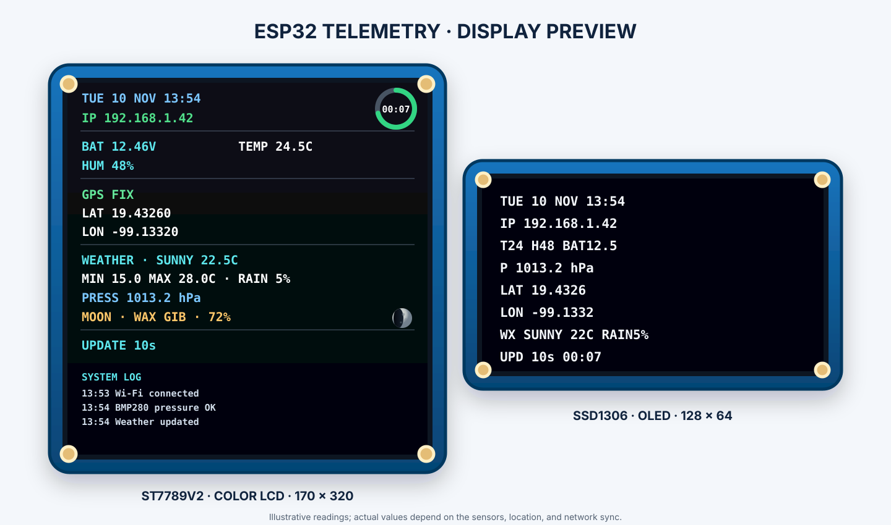
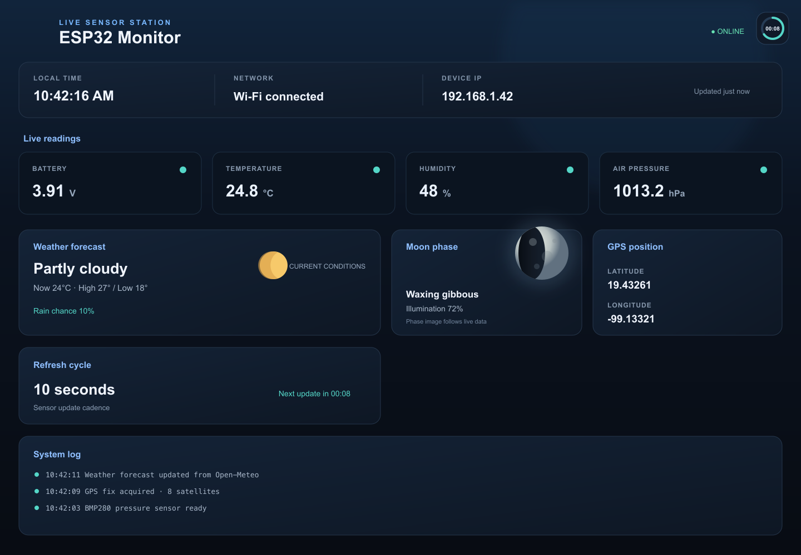

# Hardware and wiring

The dual-USB-C ESP32-S3 development board with ESP32-S3-WROOM-1 N16R8 module reads a DHT22, BMP280-3.3 pressure sensor, NEO-6M GPS, and a 0–25 V battery voltage module. It drives a 170 × 320 ST7789V2 color LCD and a 128 × 64 SSD1306 OLED. Firmware uses the ESP32-S3-DevKitC-1 GPIO map as a reference; check the labels on the exact carrier board before wiring because its physical layout may differ.

## Breadboard assembly

The board is the ESP32-S3-WROOM-1 N16R8 variant. LCD SCK/MOSI/CS/DC/RST use GPIO12/11/10/13/14; OLED SCL/SDA use GPIO9/8; DHT22 DATA uses GPIO6; GPS TX/RX use GPIO18/17; battery ADC uses GPIO4; BMP280 SDA/SCL use GPIO1/2. GPIO19/20 remain reserved for native USB; GPIO35–37 are used by octal flash/PSRAM.

## Wiring overview

The voltage module's `S` output passes through a 12 kΩ resistor before GPIO4 (ADC1_CH3). A 10 kΩ resistor connects the GPIO4 node to ground. The DHT22 DATA line has a 4.7 kΩ pull-up to 3V3 when the sensor module does not include one.

## Display layout

## Web dashboard preview

The BMP280 is powered from 3V3 and uses a dedicated I²C bus: SDA GPIO1, SCL GPIO2. Firmware scans both `0x76` and `0x77`. If it is absent, the other sensors and web server continue to operate.

See the [pin map and exact breadboard rows](https://github.com/bygregonline/esp32-sample1#pin-map) in the repository README before assembling hardware.
