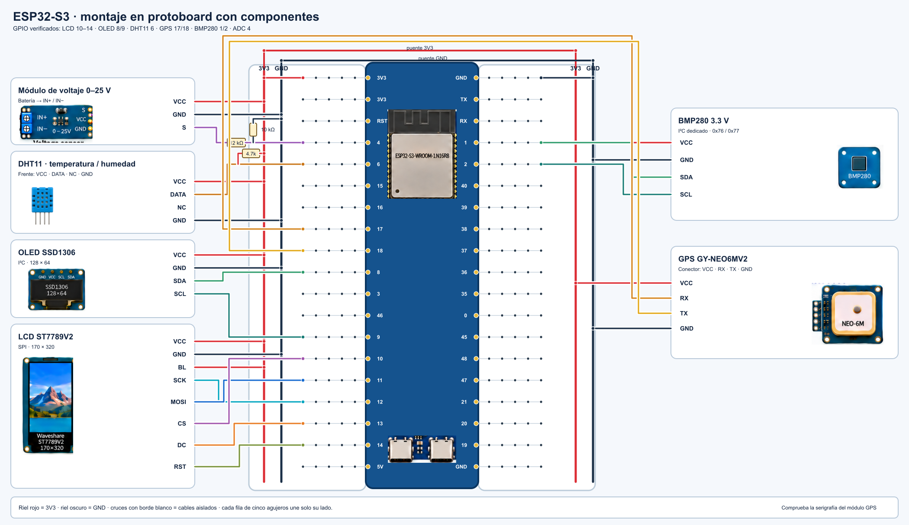
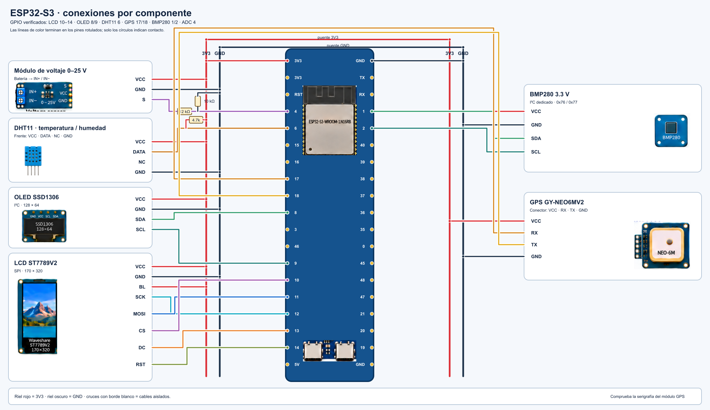
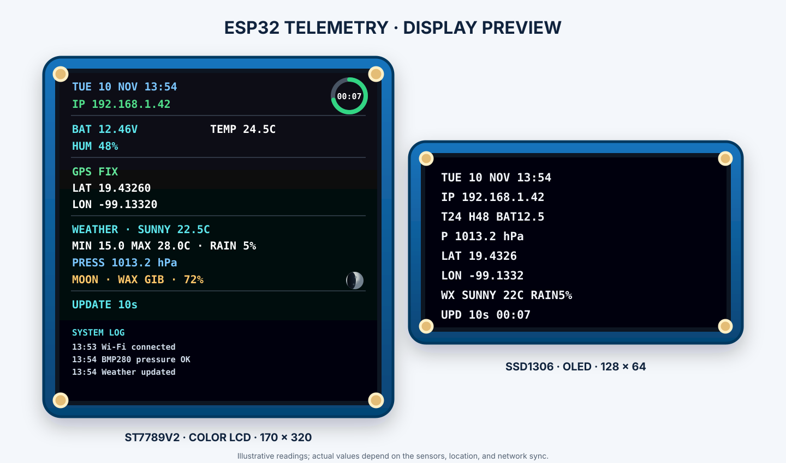
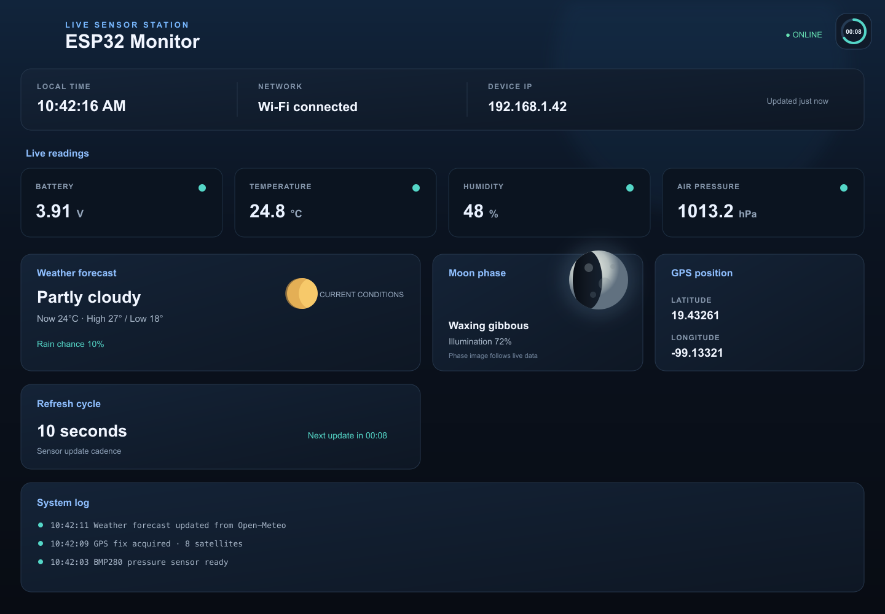

# Hardware and wiring

The dual-USB-C ESP32-S3 development board with ESP32-S3-WROOM-1 N16R8 module reads a DHT11, BMP280-3.3 pressure sensor, GY-NEO6MV2 GPS, and a 0–25 V battery voltage module. It drives a 170 × 320 ST7789V2 color LCD and a 128 × 64 SSD1306 OLED. Firmware uses the ESP32-S3-DevKitC-1 GPIO map as a reference; check the labels on the exact carrier board before wiring because its physical layout may differ.

## Breadboard assembly

The [technical breadboard diagram](visuals/diagrama-tecnico-esp32-protoboard.svg) shows component symbols, each header label, the 4.7 kΩ DHT11 pull-up, and the 12 kΩ / 10 kΩ ADC divider without photos.

Individual wiring views (each includes the ESP32-S3 pin labels): [voltage module](visuals/diagrama-componente-voltage-esp32.svg), [DHT11](visuals/diagrama-componente-dht-esp32.svg), [OLED SSD1306](visuals/diagrama-componente-oled-esp32.svg), [LCD ST7789V2](visuals/diagrama-componente-lcd-esp32.svg), [BMP280](visuals/diagrama-componente-bmp-esp32.svg), and [GPS GY-NEO6MV2](visuals/diagrama-componente-gps-esp32.svg). All nine diagrams are generated from the same pin map with `python3 scripts/generate_wiring_diagrams.py` (requires `rsvg-convert`).

The board is the ESP32-S3-WROOM-1 N16R8 variant. LCD SCK/MOSI/CS/DC/RST use GPIO12/11/10/13/14; OLED SCL/SDA use GPIO9/8; DHT11 DATA uses GPIO6; GPS TX/RX use GPIO18/17; battery ADC uses GPIO4; BMP280 SDA/SCL use GPIO1/2. GPIO19/20 remain reserved for native USB; GPIO35–37 are used by octal flash/PSRAM.

The pictured GY-NEO6MV2 connector is ordered VCC, RX, TX, GND from top to bottom, with the antenna on the right. GPS TX goes to ESP32 GPIO18 (RX), and GPS RX optionally goes to ESP32 GPIO17 (TX). Verify the labels printed on your GPS board before inserting the four leads.

## Wiring overview

The voltage module's `S` output passes through a 12 kΩ resistor before GPIO4 (ADC1_CH3). A 10 kΩ resistor connects the GPIO4 node to ground. The DHT11 DATA line has a 4.7 kΩ pull-up to 3V3 when the sensor module does not include one.

## Display layout

## Web dashboard preview

The BMP280 is powered from 3V3 and uses a dedicated I²C bus: SDA GPIO1, SCL GPIO2. Firmware scans both `0x76` and `0x77`. If it is absent, the other sensors and web server continue to operate.

See the [pin map and exact breadboard rows](https://github.com/bygregonline/esp32-sample1#pin-map) in the repository README before assembling hardware.
