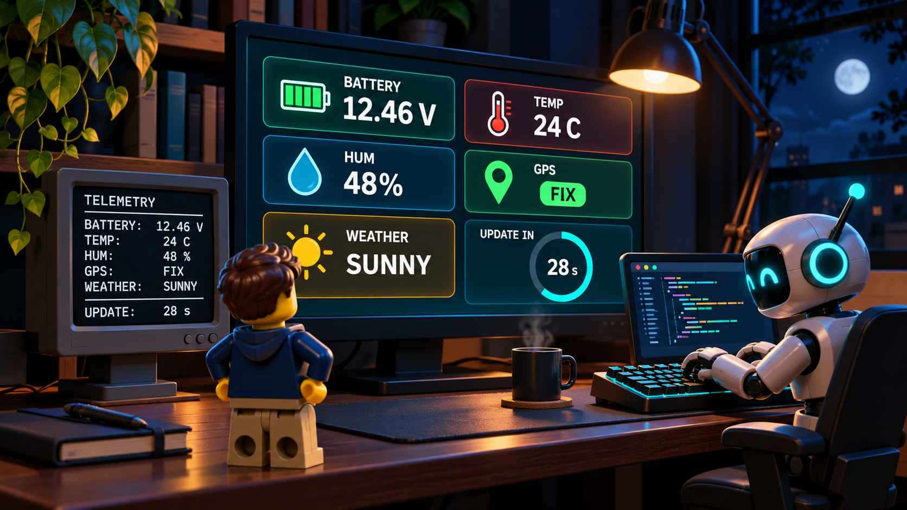

# ESP32 Telemetry Monitor

This documentation covers a telemetry monitor for the ESP32 DevKit/WROOM-32. The C, MicroPython, and Rust implementations provide sensor readings, Wi-Fi setup, an HTTP API, weather forecasts, and two displays. The Arduino sketch covers sensors and displays.

Start with [hardware and wiring](hardware.md), then choose an implementation:

- [C / ESP-IDF](c.md) — reference firmware.
- [MicroPython](python.md) — firmware copied to the board with `mpremote`.
- [Rust](rust.md) — ESP-IDF `std` firmware for Xtensa.
- [Arduino](arduino.md) — sketch for Arduino IDE or CLI.

The [HTTP API](api.md) is shared by the C, MicroPython, and Rust versions.
