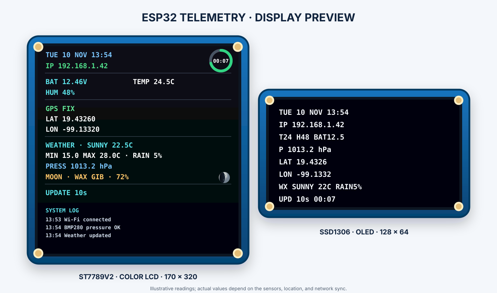
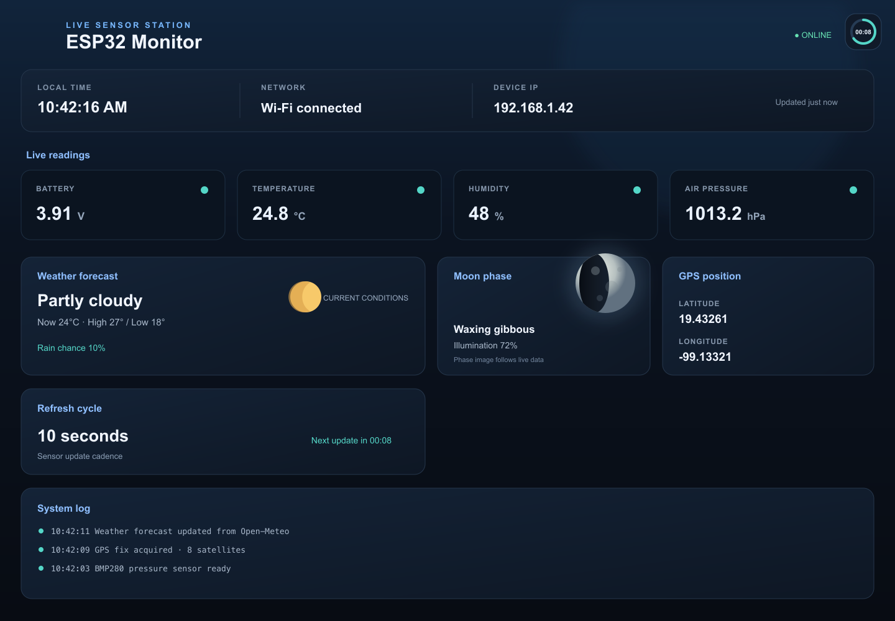

# Monitor ESP32 con MicroPython

Proyecto para placa ESP32-S3 N16R8 de doble USB-C (16 MB flash y 8 MB PSRAM), con GPIO basados en la referencia ESP32-S3-DevKitC-1. Verifica el rotulado de la placa concreta antes de cablear. Presenta batería, temperatura, humedad, presión atmosférica, posición GPS, clima y fase lunar en dos pantallas:

- Waveshare LCD de 1.9 pulgadas, 170 × 320, ST7789V2 por SPI.
- OLED de 0.96 pulgadas, 128 × 64, SSD1306 por I2C.

La LCD a color muestra un icono lunar con la zona iluminada calculada desde la fase actual; la OLED sigue mostrando el resumen compacto. El anillo de actualización aparece pequeño en la esquina superior derecha de la LCD y del dashboard web.

Los controladores de pantalla, parser GPS y driver BMP280 están incluidos. No hay paquetes de terceros que instalar en la placa. El panel web se actualiza cada dos segundos y BLE ofrece snapshots GATT de solo lectura en JSON, texto, YAML y XML; el firmware base debe incluir el módulo `bluetooth`.

La fase lunar se renderiza en un buffer BMP 64×64 reutilizable y se entrega en `/moon.bmp`. `scripts/build.sh` y `scripts/deploy.sh` incluyen `moon_image.py`.

## TensorFlow Lite Micro

La versión MicroPython conserva el firmware estándar y no ejecuta el modelo TensorFlow Lite Micro. Para el ejemplo que ejercita inferencia `float32` en el CPU/FPU del ESP32 (el chip no tiene TPU), usa la versión C o Rust; ambas ejecutan el mismo modelo publicado mediante un componente nativo de ESP-IDF. Incluir TFLM en MicroPython requeriría compilar y flashear un firmware MicroPython personalizado con un módulo C/C++ integrado; copiar archivos `.py` no agrega ese runtime.

La referencia de módulos MicroPython se genera con MkDocs y `mkdocstrings-python`: desde la raíz ejecuta `uv sync --group dev` y `./scripts/build_docs.sh`. Las dependencias de documentación están en el grupo `dev` del `pyproject.toml`; la salida queda en `site/`.

## Diagramas y pantallas

## Montaje con protoboard


### Diagrama general de conexiones


### Vista de las pantallas



### Panel web



El montaje muestra las pantallas a la izquierda del ESP32 y los sensores a la derecha. Las filas y resistencias del protoboard se detallan en el [README principal](../README.md#wiring-diagrams-and-display-mockup); los pines usados por MicroPython están en `config.py`.

## Pines predeterminados

Los pines corresponden a ESP32-S3-WROOM-1 N16R8. GPIO19/20 quedan reservados para USB nativo y GPIO35–37 para flash/PSRAM.

| Módulo | Pin del módulo | ESP32 |
|---|---|---|
| LCD Waveshare | DIN / MOSI | GPIO11 |
| LCD Waveshare | CLK / SCK | GPIO12 |
| LCD Waveshare | CS | GPIO10 |
| LCD Waveshare | DC | GPIO13 |
| LCD Waveshare | RST | GPIO14 |
| LCD Waveshare | BL | 3V3 (luz fija) |
| LCD Waveshare | VCC / GND | 3V3 / GND |
| OLED SSD1306 | SDA / SCL | GPIO8 / GPIO9 |
| OLED SSD1306 | VCC / GND | 3V3 / GND |
| BMP280-3.3 | SDA / SCL | GPIO1 / GPIO2 (I2C1) |
| BMP280-3.3 | VCC / GND | 3V3 / GND |
| DHT22 | DATA | GPIO6 |
| DHT22 | VCC / GND | 3V3 / GND |
| GPS NEO-6M | TX | GPIO18 (RX del ESP32) |
| GPS NEO-6M | RX (opcional) | GPIO17 (TX del ESP32) |
| GPS NEO-6M | VCC / GND | Según el módulo / GND común |
| Sensor de voltaje | S / salida analógica | A través del divisor adicional a GPIO4 (ADC1_CH3) |

El ESP32, el GPS y los sensores deben compartir GND. El pin TX del GPS se conecta al RX del ESP32, y viceversa. Para recibir coordenadas basta conectar TX del GPS a GPIO18; RX del GPS puede quedar desconectado.

## Conexión segura del sensor de voltaje

El módulo económico típico de 0–25 V usa un divisor 5:1. Eso puede producir 5 V en su salida analógica al medir 25 V; el GPIO del ESP32 no admite esa tensión. El proyecto agrega un segundo divisor para limitar la entrada ADC a unos 2.27 V con 25 V en la batería:

1. Batería positiva y negativa a las entradas `IN+` e `IN-` del módulo medidor.
2. Salida `S` del medidor a una resistencia de **12 kΩ**.
3. El otro extremo de 12 kΩ va al nodo de GPIO4.
4. Conecta una resistencia de **10 kΩ** entre GPIO4 y GND.
5. Une el GND del medidor, del divisor y del ESP32.
6. Si el conector de tres pines del medidor tiene `+`, `-` y `S`, conecta `-` a GND y `+` a 3V3 cuando el modelo lo requiera; `S` es la señal medida.

Comprueba el pinout de tu placa de voltaje antes de alimentarlo: existen variantes. No conectes directamente la batería ni una salida de 5 V al GPIO4. Si la batería puede superar 25 V, este divisor no es adecuado. La lectura se calibra con `VOLTAGE_CALIBRATION` en `config.py` comparándola con un multímetro.

El módulo medidor solo mide; no alimenta al ESP32. Alimenta el ESP32 desde la batería con un regulador DC-DC apropiado para la entrada de tu placa. Nunca conectes una batería directamente al pin 3V3.

## DHT22 y GPS

El DHT22 se consulta cada 2.5 segundos, como requiere este sensor. En un DHT22 sin placa adaptadora, agrega una resistencia pull-up de 4.7–10 kΩ entre DATA y 3V3. Muchos módulos de tres pines ya la incluyen.

El GPS NEO-6M usa UART2 a 9600 baudios, una configuración común de fábrica. La primera posición puede tardar y la antena suele necesitar vista despejada del cielo. Hasta que haya una posición reciente, ambas pantallas indican que el GPS está buscando señal.

## Preparar y cargar por CLI

1. Instala firmware MicroPython para tu modelo exacto de ESP32 si todavía no lo tiene. `dht`, `framebuf` y `machine` deben estar disponibles en el firmware.
2. Crea el entorno local con Python 3.12 e instala `mpremote` usando `uv`:

   ```sh
   ./scripts/install-deps.sh
   ```

3. Conecta la placa por USB y revisa el puerto con `mpremote connect list`.
4. Desde esta carpeta, prepara el paquete e instala los archivos en la placa:

   ```sh
   ./scripts/build.sh
   ./scripts/deploy.sh
   ```

`install-deps.sh` ejecuta `uv sync --project .. --python 3.12`; crea el entorno compartido en la raíz del repositorio (`.venv/`) y usa el `pyproject.toml` y `uv.lock` que también están en la raíz. Las dependencias host (por ahora `mpremote`) se instalan ahí; el firmware MicroPython de la placa solo usa módulos incluidos (`machine`, `dht`, etc.). `build.sh` reúne los módulos en `dist/esp32-monitor-python/`; MicroPython es interpretado, así que ese paquete es el artefacto de despliegue y no un ejecutable nativo. `deploy.sh` usa `mpremote` para copiar los archivos y reiniciar la placa. De forma predeterminada selecciona el primer dispositivo detectado. Para elegir uno, define `ESP32_PORT`, por ejemplo `ESP32_PORT=port:/dev/cu.usbserial-0001 ./scripts/deploy.sh`.

La placa ejecutará `main.py` al arrancar. Para ver mensajes y abrir la consola serial:

```sh
mpremote connect auto repl
```

Si tienes más de un dispositivo serial, cambia `auto` por el puerto indicado por `mpremote connect list`, por ejemplo `port:/dev/ttyUSB0`.

## Ajustes

- Cambia pines, dirección I2C y factores del divisor en `config.py`.
- La presión se reporta en hPa. La fase lunar llega con el pronóstico GPS de Open-Meteo.
- Copia `.env.example` a `.env` en la raíz y ajusta `MONITOR_TZ_OFFSET_HOURS` antes de compilar para usar otra zona horaria; el valor predeterminado es UTC−6.
- El OLED se busca en `0x3C`; muchas placas también permiten `0x3D`.
- El área visible del LCD 170 × 320 empieza en el desplazamiento X 35 del controlador; si tu revisión muestra imagen corrida, ajusta `LCD_X_OFFSET`.
- La precisión del ADC varía entre placas. Ajusta `VOLTAGE_CALIBRATION` con una medición real.
