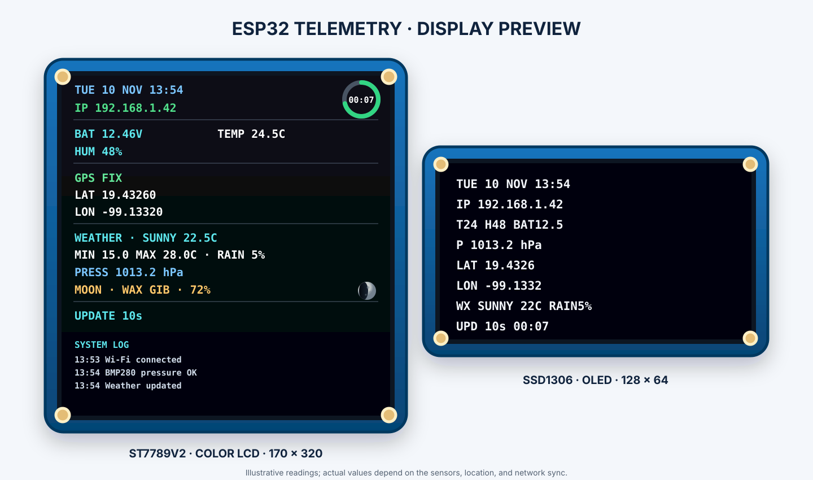
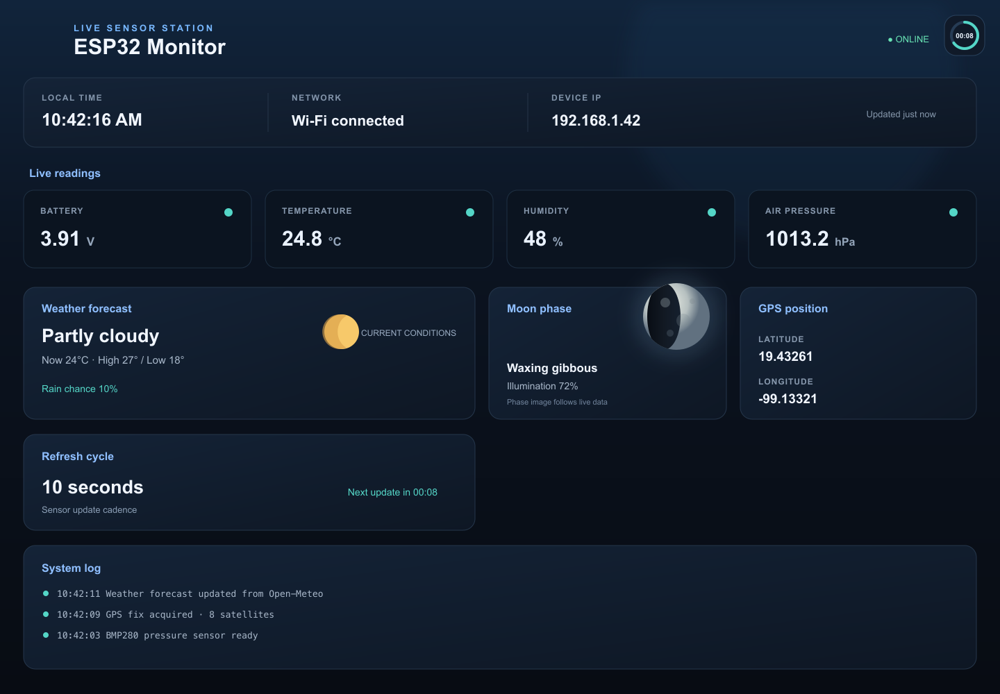

# Firmware Rust para ESP32

Versión Rust del monitor de batería, DHT22, BMP280, GPS, clima y fase lunar para las pantallas Waveshare ST7789V2 170 × 320 y SSD1306 128 × 64. La LCD a color dibuja un icono de luna cuya parte iluminada sigue la fase recibida. Está configurada para una **placa ESP32-S3 N16R8 de doble USB-C** (16 MB flash, 8 MB PSRAM), con GPIO basados en la referencia ESP32-S3-DevKitC-1; verifica el rotulado de la placa concreta antes de cablear. Usa ESP-IDF con Rust `std` mediante `esp-idf-svc`.

## Diagramas y pantallas

### Montaje con protoboard


### Diagrama general de conexiones


### Vista de las pantallas



### Panel web



El montaje muestra las pantallas a la izquierda del ESP32 y los sensores a la derecha. El [README principal](../README.md#wiring-diagrams-and-display-mockup) describe las filas y resistencias; los GPIO de esta versión se declaran en `src/main.rs`.

El dashboard web refresca el snapshot cada dos segundos, mantiene el contador circular pequeño en la esquina superior derecha y muestra la fase lunar como imagen BMP 64×64 servida en `/moon.bmp`. La LCD también dibuja un icono lunar de fase variable y el anillo de cuenta regresiva arriba a la derecha.

## Pines

| Función | GPIO |
|---|---:|
| LCD SPI SCK / MOSI | 12 / 11 |
| LCD CS / DC / RST | 10 / 13 / 14 |
| LCD BL | 3V3, luz fija |
| OLED I2C SDA / SCL | 8 / 9 |
| BMP280 I2C1 SDA / SCL | 1 / 2 |
| DHT22 DATA | 6 |
| GPS UART RX / TX | 18 / 17 |
| Voltaje ADC1 | 4 (ADC1_CH3) |

El GPS se configura a 9600 baudios. El OLED usa I2C `0x3C`; el BMP280 busca `0x76` y `0x77`; el LCD usa un desplazamiento X de 35 píxeles. Copia `.env.example` a `.env` en la raíz para configurar `MONITOR_TZ`; el valor predeterminado es la zona central de México (UTC−6).

## Documentación

Desde la raíz del repositorio, `./scripts/build_docs.sh` genera el sitio MkDocs. Para añadir la referencia nativa de los módulos Rust, ejecuta `./scripts/build_docs.sh --rust-api`; usa `cargo doc` y requiere el entorno Xtensa preparado por `rust/scripts/install-deps.sh`. El HTML queda en `site/api/rust/` y se ignora en Git.

## Entrada de batería

El módulo típico 0–25 V entrega hasta 5 V en su salida. Para limitar la entrada del ESP32, conecta `S` del módulo a GPIO4 mediante una resistencia de 12 kΩ y conecta otra resistencia de 10 kΩ entre GPIO4 y GND. Comparte GND entre ESP32, sensor de voltaje y batería. El cálculo usa la relación 5:1 del módulo más el divisor adicional 12 kΩ/10 kΩ; calibra `VOLTAGE_CALIBRATION` en `src/main.rs` con multímetro. No conectes la batería directamente al GPIO ni al pin 3V3.

## TensorFlow Lite Micro: prueba float32

Rust ejecuta el mismo modelo de demostración `hello_world` que C mediante el componente nativo compartido [`components/tflm_demo/`](../components/tflm_demo/). Usamos TensorFlow Lite Micro para ejercitar inferencia `float32` en el CPU/FPU del ESP32-S3. Este chip tiene FPU, no TPU; la prueba valida la integración del runtime, no es una prueba de TPU ni un benchmark. El modelo aproxima `sin(x)`; el firmware normaliza temperatura y humedad del DHT22 y las ejecuta en llamadas separadas. Si el DHT22 no está disponible, usa el voltaje de batería. Las predicciones aparecen en el monitor serial bajo `TFLM demo`; no son pronósticos ambientales ni alteran el API.

El proyecto Rust declara el componente compartido en `Cargo.toml`; ESP-IDF Component Manager descarga `espressif/esp-tflite-micro` al compilar. La interfaz C se consume mediante FFI desde [`src/ml_demo.rs`](src/ml_demo.rs).

## Compilar y desplegar

Para este chip Xtensa se requiere el compilador de Espressif, instalado por `espup`, además de `espflash` y `ldproxy` para generar y cargar una imagen. El proyecto usa ESP-IDF 5.4.2, igual que la versión C. La herramienta oficial se configura desde la [guía Rust on ESP](https://docs.espressif.com/projects/rust/book/getting-started/toolchain.html). Ejecuta el script una vez en la computadora de desarrollo; instala las herramientas en el perfil de usuario con Cargo y descarga las crates declaradas en `Cargo.toml`:

```sh
./scripts/install-deps.sh
```

El script genera el archivo de entorno como `rust/export-esp.sh`, lo ignora en Git y lo carga automáticamente al compilar. En otras terminales puedes cargarlo manualmente con `. ./export-esp.sh` desde `rust/`.

## Actualizar dependencias

Desde `rust/`, ejecuta `./scripts/update-deps.sh` para actualizar las crates permitidas por `Cargo.toml` y descargar las versiones resueltas. El script actualiza `Cargo.lock`; revisa ese diff y compila después con `./scripts/build.sh`. Las versiones de componentes ESP-IDF se resuelven aparte desde `components/tflm_demo/idf_component.yml` y se fijan en `components_esp32.lock`.

## Compilar sin placa y cargar cuando esté disponible

Desde `rust/`, ejecuta:

```sh
./scripts/build.sh
```

El firmware también levanta la página web con actualización automática y el servicio BLE NimBLE `0xFFA0`. Las características `0xFFA1`–`0xFFA4` sirven la misma instantánea en JSON, texto, YAML y XML. La dependencia fijada `esp-idf-svc` incluye un parche local de conversión de flags para compilar su módulo NimBLE con los tipos de ESP-IDF 5.4.2.

El ELF queda en `target/xtensa-esp32s3-espidf/release/esp32-monitor-rust` y la imagen de aplicación queda en `firmware.bin`. No hace falta conectar la placa para compilarlos. Cuando esté conectada por USB, ejecuta `./scripts/deploy.sh`. Para fijar el puerto serial, usa `ESP32_PORT=/dev/cu.usbserial-0001 ./scripts/deploy.sh`. El script vuelve a compilar y flashea el ELF con `espflash`; `firmware.bin` queda como artefacto separado para transferir o archivar. La referencia del flasher está en la [guía oficial de espflash](https://docs.espressif.com/projects/rust/book/getting-started/tooling/espflash.html).
