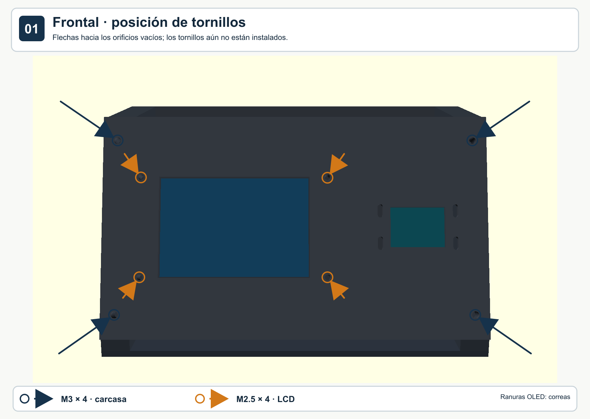
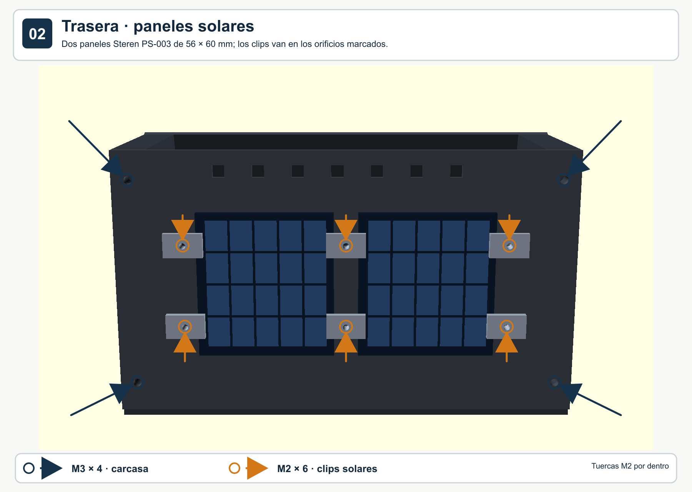
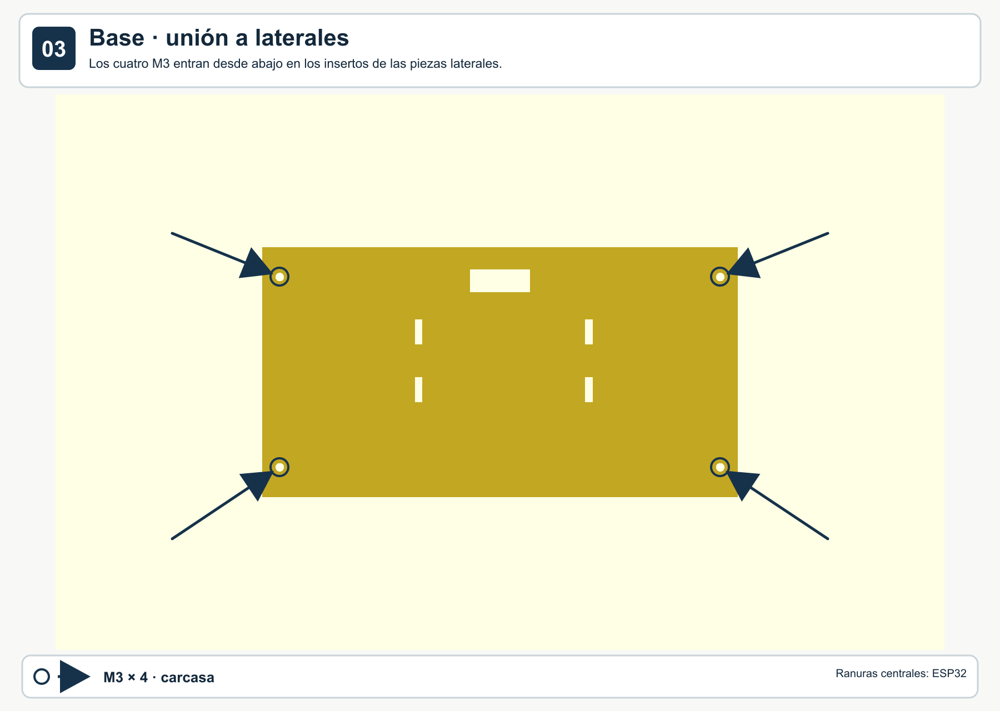

# Carcasa imprimible para ESP32-S3

El modelo OpenSCAD muestra un frontal inclinado con una pantalla **ILI9488 SPI de 3.5 pulgadas, 480 × 320**, una OLED SSD1306 y **dos paneles solares en la cara posterior**. Los renders se producen desde el mismo CAD que los STL.

## Renders de ensamble

Las flechas apuntan a los **orificios vacíos**; no se dibujan tornillos instalados. Azul = tornillos M3 de la carcasa; naranja = tornillos del LCD o de los clips solares.

| Frontal | Trasera | Base |
|---|---|---|
|  |  |  |

También están disponibles los renders CAD [frontal](preview.png), [posterior](preview-back.png) y [de la base](preview-base.png) sin anotaciones. Los archivos SVG y PNG con flechas se generan a partir de esas vistas con `python3 supportfiles/3d/generate_manual_renders.py`; la carpeta incluye el script fuente para volver a dibujarlas después de renderizar el CAD en OpenSCAD.

## Archivos para imprimir

| Archivo | Cantidad | Función |
|---|---:|---|
| [Frontal](esp32_mvp_front.stl) | 1 | Ventana ILI9488, ventana OLED, cuatro soportes perforados para el LCD y cuatro tornillos M3 de ensamble |
| [Trasera](esp32_mvp_back.stl) | 1 | Dos ubicaciones solares, seis orificios M2 para clips, pasos de cable y cuatro tornillos M3 |
| [Base](esp32_mvp_base.stl) | 1 | Paso de cables, ranuras para sujetar la placa ESP32 y cuatro tornillos M3 |
| [Lateral](esp32_mvp_side.stl) | 2 | Perfil inclinado con taladros alineados para insertos M3 en frontal, trasera y base |
| [Clip solar](esp32_mvp_solar_clip.stl) | 6 | Sujeta los bordes de ambos paneles con tornillos M2 |

El [ensamble STL](esp32_mvp_assembly.stl) sirve para inspección; se imprimen los archivos individuales. El fuente editable es [esp32_mvp_mount.scad](esp32_mvp_mount.scad).

## Medidas y ajuste antes de imprimir

- Carcasa: **190 mm de ancho**, frontal de **110 mm de alto**, base de **100 mm de profundidad** y **18°** de inclinación.
- La pantalla está orientada horizontalmente. El modelo usa como referencia un PCB SPI ILI9488 de **98 × 56.34 mm** y área visible de **73.44 × 48.96 mm**, según el [fabricante Elecrow](https://media-cdn.elecrow.com/wiki/35inch-480x320-mcu-spi-serial-tft-lcd-module-display.html). La separación de orificios **92 × 49.5 mm es provisional** y debe medirse en el módulo comprado antes de imprimir.
- Cada posición solar mide **56 × 60 × 3 mm**, según el [panel Steren PS-003](https://www.steren.com.mx/panel-solar-de-3-vcc-y-150-ma.html) indicado como referencia. Sus seis clips sujetan los bordes sin exigir perforaciones en el panel. Si los paneles comprados difieren, cambia `solar_w`, `solar_h` y `solar_t` en el SCAD antes de imprimir.
- Los orificios de paso M3 son de **3.4 mm**; los laterales tienen taladros de **4.2 mm** para insertos térmicos M3, que deben ajustarse al inserto comprado. Los seis clips solares usan orificios de **2.5 mm** para tornillos M2 con tuercas por el interior de la tapa trasera. El PCB del LCD se fija con M2.5 a través de sus cuatro soportes; confirma antes la separación real de orificios.
- La OLED usa ranuras ajustables porque los PCB SSD1306 no comparten una sola distribución de orificios. La base usa ranuras para correas de la placa ESP32, sin fijar un patrón de orificios de una placa no medida.

Los paneles en los renders son volúmenes de referencia. La fijación mecánica y el paso de cables están modelados; el controlador de carga, la batería y su cableado eléctrico quedan fuera de este CAD.

## Exportar y ensamblar

En la raíz del repositorio, por ejemplo:

```sh
openscad -D 'part="front"' -o supportfiles/3d/esp32_mvp_front.stl supportfiles/3d/esp32_mvp_mount.scad
```

Usa `part="back"`, `"base"`, `"side"`, `"solar_clip"` y `"assembly"` para los otros STL. El lateral se exporta acostado y el frontal con los soportes hacia arriba. Imprime una prueba corta de ajuste antes de imprimir todas las piezas; elige el largo de los tornillos según el espesor real de la impresión y de los paneles.
