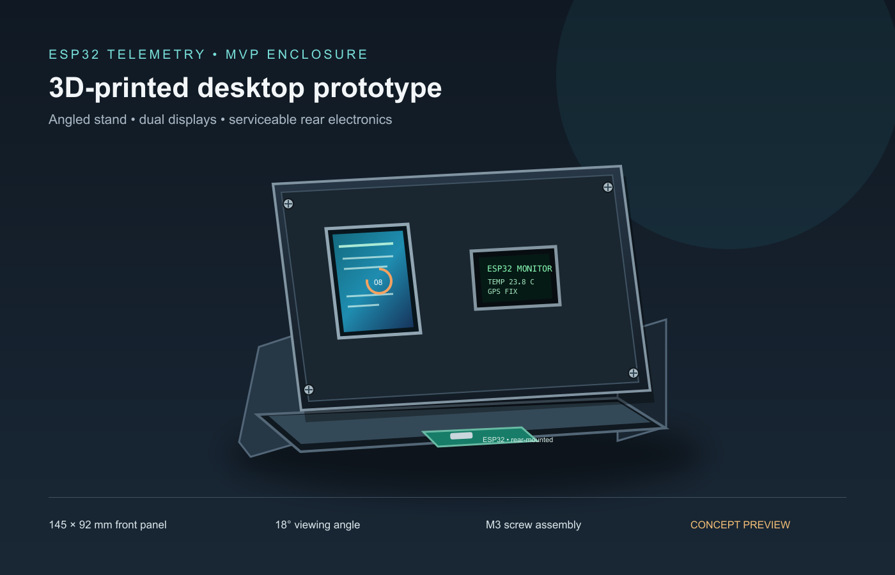

# 3D-printed MVP enclosure

This folder contains the editable OpenSCAD model and its preview. The design is a compact, angled desktop stand for the ESP32 telemetry MVP, with the 1.9-inch color LCD and 0.96-inch OLED visible on the front and the ESP32 mounted behind the panel.

## Files

- `esp32_mvp_mount.scad` — parametric, multi-part OpenSCAD model. Set `part` to `assembly`, `front`, `back`, or `side` before exporting an STL. Export each part separately for printing.
- `esp32_mvp_assembly.stl` — assembled model for interactive viewing in GitHub and for checking the complete shape in a slicer.
- `esp32_mvp_front.stl`, `esp32_mvp_back.stl`, `esp32_mvp_side.stl` — printable parts; print two copies of the side piece.
- `preview.svg` — vector source for the preview image.
- `preview.png` — rendered concept view; it is an illustration, not a dimension inspection.

When the repository is on GitHub, open the [assembly STL](esp32_mvp_assembly.stl) to rotate, pan, and zoom it in GitHub's 3D viewer. The file is below GitHub's 10 MB rendering limit. The preview image in the root README links to this viewer.

## Starting dimensions

The front plate is 145 × 92 × 3 mm. Display windows are 24 × 44 mm for the Waveshare 1.9-inch LCD and 27 × 20 mm for a nominal 0.96-inch OLED. The stand uses two side cheeks and an 18° viewing angle. M3 clearance holes are 3.4 mm.

The Waveshare module itself is 27.3 × 51.2 mm. Generic SSD1306 breakout boards vary; the model assumes a board up to 29.2 × 26.7 mm. Mounting-hole locations vary by vendor, so the model uses adjustable slots rather than claiming a universal PCB hole pattern. Measure the exact modules and adjust the parameters at the top of the SCAD file before printing the final parts.

## Print and assembly

Print the front and rear plates flat, with the display side facing up. Print two side cheeks flat. Use 0.2 mm layers, 3 perimeters, and 20–30% infill as a starting point. Use M3 screws and nuts with small right-angle brackets to join the cheeks to the front and rear plates; use M2/M2.5 nylon standoffs or small printed straps to retain the actual display and ESP32 PCBs. Leave the ESP32 USB connector and antenna area unobstructed. Route sensor leads through the rear opening.

These are prototype dimensions. Check display alignment and screw positions against the physical boards before a long print. To refresh the STLs after editing the SCAD model, run `openscad -D 'part="front"' -o supportfiles/3d/esp32_mvp_front.stl supportfiles/3d/esp32_mvp_mount.scad`; use `part="back"`, `part="side"`, and `part="assembly"` for the other exports.
