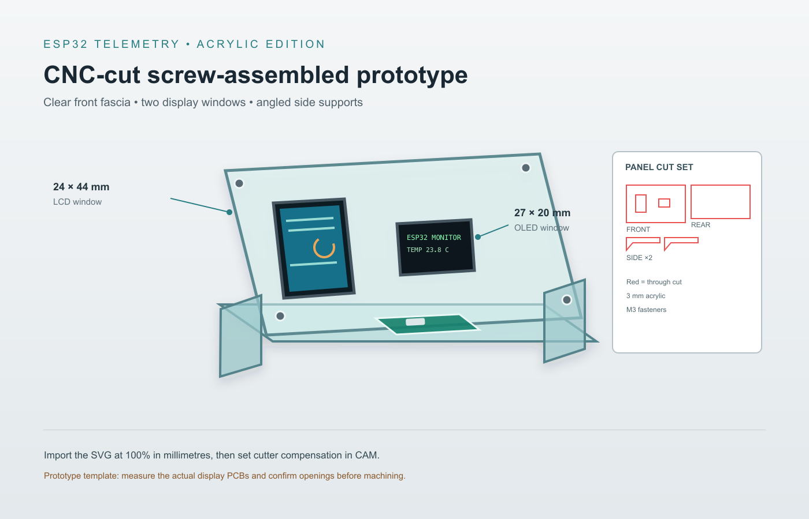

# CNC-cut acrylic MVP enclosure

This folder contains a 1:1 metric SVG cutting layout for a screw-assembled acrylic desktop enclosure, plus a preview image. The ESP32 and both displays sit behind a clear or opaque front panel; cutouts expose the LCD and OLED. The lower plate supports the electronics, and the two triangular side plates set the viewing angle.

## Files

- `esp32_mvp_acrylic_panels.svg` — CNC profile layout in millimetres. Red paths are through-cuts. Each part is labeled and nested on a 300 × 200 mm sheet.
- `preview.svg` — vector source for the preview image.
- `preview.png` — rendered concept view; use the cutting SVG for geometry.

## Cut list and setup

The layout includes one 145 × 92 mm front panel, one 145 × 82 mm rear panel, and two side cheeks with an 82 × 118 mm envelope. Front-panel openings are 24 × 44 mm (LCD), 27 × 20 mm (OLED), and 3.4 mm mounting holes. Side-cheek edges form the tilted desktop stand. The design targets 3 mm acrylic, M3 screws/nuts, and eight small right-angle brackets joining the cheeks to the front and rear panels. Use washers to avoid point-loading the acrylic.

Import the SVG at 100% scale with units set to mm. Confirm the CNC/CAM software interprets the viewBox as millimetres, apply tool compensation for the actual bit diameter, and add dogbones only if your assembly requires them. Run a small scale check before cutting the full sheet. Do not scale to fit the sheet.

The cutouts are starting dimensions. Waveshare lists the 1.9-inch module body as 27.3 × 51.2 mm and the display area as 22.7 × 42.72 mm. The generic 0.96-inch SSD1306 board is not specified by the project; board dimensions and mounting-hole positions vary by vendor. Measure the actual modules and tune the SVG before machining. The SVG uses nominal module windows, not vendor-specific PCB mounting holes.

The SVG contains profiles only; it does not encode toolpaths, feeds, speeds, or tabs. Set those in the CAM software for the acrylic thickness and cutter being used.
